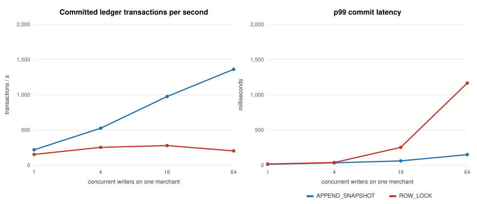

# Driftline

**Payment reconciliation as a stream, with its correctness shown by deterministic simulation.**

Driftline watches three records of every UPI merchant payment (the merchant's order events, the payment gateway's
webhooks and the bank's settlement file), notices the moment they disagree, and resolves the disagreement before its
deadline: it refunds, fulfils, posts fees, holds money in suspense, or escalates to a person with the evidence
attached. The matcher, resolver, dispatcher and ledger that run in production also run, unchanged, inside a
simulator that controls the clock, the network, storage and every fault, so any failure it finds replays exactly
from one seed.

Every number below is generated from a committed raw output in [`docs/results/`](docs/results/) by
[`scripts/render-results`](scripts/render-results); CI fails if this file and those outputs disagree. Section numbers
(§) and decision numbers (D) refer to [`docs/DESIGN.md`](docs/DESIGN.md).

- [The problem](#the-problem)
- [What it does](#what-it-does)
- [Architecture](#architecture)
- [Guarantees and limits](#guarantees-and-limits)
- [The numbers](#the-numbers)
- [Simulation and canaries](#simulation-and-canaries)
- [Bug log highlights](#bug-log-highlights)
- [Security](#security)
- [Who would pay, and why](#who-would-pay-and-why)
- [Prior art](#prior-art)
- [How to run it](#how-to-run-it)
- [Repository map](#repository-map)

## The problem

Every online payment is recorded three times: in the merchant's order database, in the gateway's event stream and in
the bank's settlement file. Networks time out, callbacks arrive twice or out of order, files arrive a day late, and
the three records drift apart. The customer sees "money debited, order not placed"; the merchant's finance team sees
a settlement that does not match its orders, and opens a spreadsheet.

In India this is also a deadline problem. RBI's circular
[RBI/2019-20/67](https://www.rbi.org.in/scripts/NotificationUser.aspx?Id=11693) sets turnaround times for failed
transactions, among them T+5 days to reverse a UPI merchant payment whose confirmation never reached the merchant,
after which the customer is owed ₹100 a day without having to complain. Reconciliation is usually a nightly batch;
Driftline does it as a stream, so a break is raised when the record that reveals it is processed, and a break that
only time can reveal (a payment missing from settlement) is raised when its due date passes in event time.

## What it does

| Break | What the records show | What Driftline does |
|---|---|---|
| Debited, no order | The gateway says success; the merchant's order is pending or failed | Re-queries the gateway; if confirmed and the order has expired, refunds; starts the deadline clock |
| Late success | A failure, then a success, for the same payment | Fulfils or refunds, depending on the order's current state |
| Duplicate capture | Two successful payments for one order | Refunds the second |
| Short settlement | The settled amount is below the expected amount | Posts fee and tax entries if itemised lines explain the gap; otherwise escalates |
| Missing settlement | A successful payment is absent from settlement by its due date | Escalates with the evidence attached |
| Orphan settlement | A bank line matches no known payment | Holds it in a suspense account and flags it |

Anomalies (a conflicting settlement file, a stalled feed, a reused idempotency key with a different body, a status
that contradicts itself) are always escalated (§8.2). Every action goes through a transactional outbox, every refund
carries an idempotency key derived from the payment, and every economic event is posted once to an append-only
double-entry ledger in PostgreSQL in which every transaction sums to zero.

Out of scope for v1 (§1): partial refunds, chargebacks and disputes; cards and other currencies; real bank
connectivity; a web UI (the ops surface is the ops API, Grafana and a CSV export); Kafka transactions; more than one
region.

## Architecture

```
  UPPER BAND  (production adapters; the simulator replaces all of this)
 +--------------------------------------------------------------------------------+
 |  gateway webhooks --+                                                          |
 |  merchant orders ---+--> Ingest API (HMAC, scopes, idempotency key) --+        |
 |  bank files ---------> Settlement upload --> Settlement worker -------+--> Kafka|
 |  SystemClock     HttpNetwork (java.net.http)     PostgresStore (JDBC)          |
 |  Kafka partition driver      poll drivers (resolver, dispatcher)               |
 +-------------------------------+----------------------------^-------------------+
          inputs: batches, ticks,|                            | three ports:
          call results           v                            | Clock, Network, Store
 +--------------------------------------------------------------------------------+
 |  CORE  (identical in production and simulation; JDK only, no I/O, no threads)  |
 |                                                                                |
 |   Matcher ------- breaks -------> Resolver ------> Outbox ------> Dispatcher   |
 |   (dedupe, state machines,       (break state      (durable       (calls out   |
 |    join, watermarks, timers,      machine,          intents)       through     |
 |    settlement solver)             deadlines)                       Network)    |
 |      |                                                                         |
 |      +--> Ledger (single writer per merchant partition)                        |
 +--------------------------------------------------------------------------------+
```

- **Ingest** (Spring Boot, only in `app`) verifies each gateway webhook's HMAC signature within a replay window,
  checks the token's merchant and scopes, requires an idempotency key on every write, and publishes to one Kafka
  topic partitioned by merchant, so a merchant's three sources stay in one ordered stream. Settlement files go to a
  separate worker that parses, validates and publishes their lines.
- **The matcher** is a stateful stream processor in plain Java, without Flink: keyed state per open payment, a
  three-way join, explicit legal transitions for payments and orders, a dedupe row written in the same PostgreSQL
  transaction as the state change and the Kafka offset (no Kafka transactions, D2), partition epochs that fence a
  paused "zombie" instance, event-time watermarks, and an exact subset-sum solver for settlement lines that arrive
  without references. It never guesses: if two different sets of payments fit a line, the line is reported as
  ambiguous with both witnesses.
- **The core is sans-I/O** (§3.1): it takes inputs (a batch, a tick, a call's result) and returns decisions; drivers in
  the upper band own the loops, the threads and the I/O. The build forbids wall clocks, unseeded randomness, threads,
  I/O, hash-ordered collections and default-locale formatting in `core`, `wire` and `sim` (ArchUnit rules).

## Guarantees and limits

What follows is DESIGN §2, copied word for word, except the refund row of the table, which states the rule that
replaced it after [BUG-008](docs/BUGS.md) (D70); after it come the known weaknesses.

<!-- claims:allow -->
### Claims

**Delivery is at-least-once everywhere.** Gateways redeliver webhooks. Merchants retry. Consumers re-read after a crash. The dispatcher retries calls. No component assumes a message arrives exactly once.

**Effects are idempotent, so the observable outcome is *effectively-once*.** Under the failure model in §2.3, any mix of duplicated, reordered, delayed or lost-then-retried messages, and any process crash between or inside transactions, still gives:

- (a) each source event changes Driftline's state at most once;
- (b) each payment is refunded at most once at the gateway;
- (c) each economic event is recorded in the ledger at most once;
- (d) no refund that was decided is ever lost.

| Effect | Mechanism | Atomic with |
|---|---|---|
| State change caused by an event | Dedupe row `(merchant, source, event_key)` inserted in the same DB transaction as the state change | PostgreSQL transaction |
| Consumer progress | Kafka offsets stored **in PostgreSQL** in that same transaction, fenced by a partition epoch (§5.1) | PostgreSQL transaction |
| Refund at the gateway | Outbox row written in the same transaction as the decision. `Idempotency-Key` derived from the payment. A refund lookup before every retry, and a resend only if no refund exists and only under the command's lease (D70, which replaced the key-TTL rule after BUG-008) | PostgreSQL transaction + the gateway's key store |
| Ledger record | `UNIQUE(merchant_id, cause_type, cause_id)` plus `ON CONFLICT DO NOTHING` plus an equality check on conflict | PostgreSQL constraint |

### Non-claims

- **No "exactly-once processing" claim.** Kafka's exactly-once semantics (idempotent producer plus transactions) cover read-process-write *inside Kafka*. Driftline writes to PostgreSQL and calls an HTTP gateway, so Kafka EOS does not apply and is not used. The idempotent producer is switched on because it removes producer-retry duplicates within one producer session. Correctness does not depend on it.
- If a gateway ignores idempotency keys *and* its refund lookup API is wrong, a double refund is possible. The fake gateway honours keys for a limited time (the TTL), and its lookup API is eventually consistent. The README states this assumption.
- The simulator's store is in-memory and runs transactions one at a time, so isolation anomalies are invisible to it. They are tested against real PostgreSQL (§11.9).
- PostgreSQL durability is assumed: no lost commits and no lying fsync.
- Watermarks on the gateway and merchant streams are heuristics (bounded out-of-orderness). Events that arrive behind the watermark are still processed and counted, and they can change a decision only by the rules in §5.6.

### Failure model (what the simulator injects)

- Process crash at any point between transactions and at named crash points (§9.4).
- Process pause, then resume as a zombie after its partition has been reassigned.
- Message drop, duplicate, delay and reorder.
- Ambiguous calls: the effect is applied but the response is lost.
- Database unavailability windows.
- Per-node clock skew, plus forward and small backward clock jumps.
- Late, duplicated, conflicting and incomplete settlement files.
- Stale reads from the gateway's status API.
- Expiry of gateway idempotency keys.
<!-- claims:end -->

### Known weaknesses

What Driftline does not do, or cannot show (D73, as later decisions changed it):

- **The delivery bound.** A refund attempt held in the network for longer than the gateway's idempotency-key TTL
  could still be refunded twice (D62); the simulator enforces the bound as an assumption. The driver's request
  timeout (10 s) is shorter than the dispatcher's lease (30 s), and start-up refuses a configuration where it is not.
- **The Compose end-to-end run cannot show a duplicate refund or an accepted late success**: its injected worlds lie
  in the past (D51), so a duplicate is already past its deadline and a late success's order expired long ago. The
  simulator and the resolver's unit tests prove both paths on every pull request.
- **The payment sweep takes a day's captures in one answer** (D72); a gateway that pages its list would need a cursor.
- **New merchants need a restart** (D49). Webhook secrets, which once did too, now rotate while running (D76).
- **Stored customer contacts are kept forever**: no retention period or erasure on request, and the first contact
  seen for a payment wins (D77).
- **Nothing in production schedules the balance snapshotter** (D81). Nothing in production reads a balance either, so
  this costs nothing today, but under the default `APPEND_SNAPSHOT` strategy a balance read grows with the entries
  since the last snapshot.
- **The numbers come from one 4 GB laptop** (§15.1) running every service at once; tail latencies there vary between
  runs of the same rate (see [the load test](#throughput-and-latency)).
- **Security residual risks** ([`docs/THREAT_MODEL.md`](docs/THREAT_MODEL.md)): no TLS or Kafka authentication inside
  the deployment, no rate limiting, API tokens that never expire (they can be revoked), encryption keys from the
  environment rather than a KMS, and an unauthenticated management port reachable only inside the deployment network.
- **The brief's finance-ops interview was not held**; public desk research stands in for it (D54, and
  [below](#who-would-pay-and-why)).

Manual ledger adjustments, once on this list, are built (D74): an ops token with the `ledger:adjust` scope posts a
balanced correction, and its audit row commits in the same transaction.

## The numbers

Measured by the methods of §17. The REQUIREMENTS ask for three numbers: events per second sustained on a laptop with
the p99 time from event to match; the share of breaks resolved automatically, per type; and the seeds run with zero
invariant violations, with the count of real bugs the simulator caught.

### Throughput and latency

An open-model generator (each arrival fires at its scheduled time, whatever the responses do, so a slow system cannot
slow the arrivals and hide its own latency) sends signed gateway webhooks and merchant order events through the real
ingest API to the Compose stack, stepping the rate up 10 minutes at a time (D82).

<!-- results:load -->
**Highest sustained rate: 50 events/s** (the limit lies between 50 events/s and the next step, 100 events/s). Each step ran 10 minutes; the columns describe its last 5.

| Offered (events/s) | Result | Consumed (events/s) | Event-to-match p50 | p99 | Requests accepted | Largest backlog (records) | Longest GC pause |
|---|---|---:|---:|---:|---:|---:|---:|
| 25 | sustained | 25.0 | 15 ms | 46 ms | 15,000 of 15,000 | 2 | 0.10 s |
| 50 | sustained | 50.0 | 28 ms | 1.5 s | 30,000 of 30,000 | 37 | 0.18 s |
| 100 | not sustained: consumer lag grew 3.14 records/s | 99.9 | 1.1 s | 38.3 s | 60,000 of 60,000 | 2,889 | 1.29 s |
| 25 (50% of 50) | sustained | 25.0 | 17 ms | 2.7 s | 15,000 of 15,000 | 57 | 0.21 s |
| 40 (80% of 50) | sustained | 39.8 | 26 ms | 2.0 s | 24,000 of 24,000 | 71 | 0.19 s |

*Sustained:* over the last 5 minutes of a 10-minute step, consumer lag (end offsets minus stored offsets, D83) did not grow and the generator saw no rejection, error, skip or unanswered request (DESIGN §17).

Setup: host: Linux 6.6.87.2-microsoft-standard-WSL2, 12 cores, 3 GB RAM; Compose profile core plus Prometheus; LOAD_RATES="25 50 100 200 400" LOAD_STEP_SECONDS=600; containers: driftline (every role in one JVM, -Xms256m -Xmx256m SerialGC, 512 MB), Kafka 640 MB, PostgreSQL 256 MB, sandbox 256 MB, Prometheus 160 MB; generator -Xmx192m.

*Raw output: [`load-summary.json`](docs/results/load-summary.json), `docs/results/load-step-*.json`, `docs/results/load-p99-*.json`, [`load-test.txt`](docs/results/load-test.txt). Written by `scripts/load-test.sh`, `scripts/load-evaluate.py`; rendered by `scripts/render-results`.*
<!-- /results:load -->

The first step and the re-run at 50% of the highest sustained rate offered the same 25 events/s and got about the
same p50, but the re-run, which came right after the overloaded 100 events/s step, had a far higher p99. On this
laptop the tail varies that much between runs of one rate, so both are reported rather than the better one. The step
records also carry the GC pauses and the machine's busiest second, which separate a tail the machine caused from one
Driftline caused (D82). Event-to-match runs from ingest's receipt of an event to the matcher commit that applied it
(every applied event, D78).

### How soon a break is found

Reconciliation as a stream means a break in the payment stream is raised minutes after it happens, not the next
morning. Each type waits only as long as its rule must (§5.5, D39). A late success is raised when the success event is
applied. A duplicate capture waits 2 minutes (`bound_G`) after the last capture, in case more arrive, and money taken
with no order waits 10 minutes (`orderGrace`) for the order to catch up; both waits are timers on the event-time
watermark, which trails the newest event by 2 minutes, or by up to 4 when the stream goes quiet. Under faults some
breaks come later, for example when the success webhook is lost and only a status probe or the bank's file reveals the
payment. A forward jump of a matcher's clock can do the opposite: the quiet-stream rule advances the watermark by that
clock, so a timer can fire before its wait is over. The break is then raised early; if the order turns up before any
action is decided, the break heals itself, and after that it is escalated (§5.6, late evidence). The simulator counts,
for every raised break, the simulated time from the world's capture to the commit that raised it:

<!-- results:detection-lag -->
How long after the simulated world captured the payment each stream break was first committed, in simulated time, over the same 10,000 seeds of each profile (`calm`: no faults; `pr`: faults on).

| Profile | Type | Breaks | Within 1 min | Within 5 min | Within 15 min | Within 1 h | Within 1 day | Later |
|---|---|---:|---:|---:|---:|---:|---:|---:|
| calm | DEBITED_NO_ORDER | 64,412 | 0% | 0% | 100% | 100% | 100% | 0% |
| calm | LATE_SUCCESS | 47,913 | 100% | 100% | 100% | 100% | 100% | 0% |
| calm | DUPLICATE_CAPTURE | 39,891 | 0% | 3.6% | 100% | 100% | 100% | 0% |
| pr | DEBITED_NO_ORDER | 121,281 | <0.1% | <0.1% | 81.3% | >99.9% | 100% | 0% |
| pr | LATE_SUCCESS | 62,476 | 97.8% | 98.4% | 99.1% | >99.9% | 100% | 0% |
| pr | DUPLICATE_CAPTURE | 52,728 | 0.1% | 3.9% | 97.3% | 99.9% | >99.9% | <0.1% |

calm: command: ./gradlew -q :sim:campaign --args="--profile calm --from 1000000000001 --count 10000 --threads 8 --double-run 100"; base commit: 52086f6 plus the detection-lag statistic (D89); the same seeds as the pr run, with no faults; date: 2026-11-24T14:01Z.
pr: command: ./gradlew -q :sim:campaign --args="--profile pr --from 1000000000001 --count 10000 --threads 8 --double-run 100 --summary docs/results/sim-summaries/local-pr-10k-shift10.json"; base commit: 52086f6 plus the detection-lag statistic (D89; it adds the detection_lag totals and changes no other line); same seeds as the a8ed8d3 and ab9d084 runs it replaces; date: 2026-11-24T14:01Z.

*Raw output: [`sim-campaign-calm-10k-shift10.txt`](docs/results/sim-campaign-calm-10k-shift10.txt), [`sim-campaign-pr-10k-shift10.txt`](docs/results/sim-campaign-pr-10k-shift10.txt). Written by `./gradlew :sim:campaign`; rendered by `scripts/render-results`.*
<!-- /results:detection-lag -->

Settlement breaks are not in this table: a short or orphan settlement can only be found when the bank's file arrives,
and a missing settlement only once its due date has passed (§5.6), so their timing is the bank's, not Driftline's. On
real hardware the processing time of the throughput test above comes on top.

### Hot accounts

A large merchant's gateway-receivable and clearing accounts are touched by every capture. Two strategies, both built
and measured against a real PostgreSQL 17 (§7.5, D81): `ROW_LOCK` updates a balance row in each posting;
`APPEND_SNAPSHOT` only appends entries and computes a balance from the last snapshot plus the entries after it, using
the `xid8` horizon so that no in-flight transaction is skipped.

<!-- results:hot-accounts -->
| Strategy | Concurrent writers | Commits/s | Commit p50 | Commit p99 | Balance read p50 | Balance read p99 | Errors |
|---|---:|---:|---:|---:|---:|---:|---:|
| ROW_LOCK | 1 | 152.4 | 5.7 ms | 16.0 ms | 1.7 ms | 6.2 ms | 0 |
| ROW_LOCK | 4 | 252.2 | 14.6 ms | 37.0 ms | 2.3 ms | 9.7 ms | 0 |
| ROW_LOCK | 16 | 277.7 | 41.8 ms | 252 ms | 1.8 ms | 7.7 ms | 0 |
| ROW_LOCK | 64 | 202.2 | 250 ms | 1165 ms | 2.7 ms | 13.9 ms | 0 |
| APPEND_SNAPSHOT | 1 | 217.6 | 4.0 ms | 12.3 ms | 2.0 ms | 7.5 ms | 0 |
| APPEND_SNAPSHOT | 4 | 524.2 | 5.7 ms | 32.2 ms | 3.8 ms | 11.4 ms | 0 |
| APPEND_SNAPSHOT | 16 | 974.7 | 13.7 ms | 61.0 ms | 11.1 ms | 67.8 ms | 0 |
| APPEND_SNAPSHOT | 64 | 1360.5 | 39.4 ms | 149 ms | 33.3 ms | 138 ms | 0 |

Setup: host: Linux 6.6.87.2-microsoft-standard-WSL2, 12 cores, 3915 MB RAM, swap used at start 296 MB; postgres: PostgreSQL 17.12 (Debian 17.12-1.pgdg13+1) on x86_64-pc-linux-gnu; container memory 768 MB; shared_buffers=128MB, fsync=on, synchronous_commit=on, isolation READ COMMITTED; runs: 5 s warm-up then 20 s measured, per strategy and writer count; one merchant, distinct captures; a reader every 50 ms; APPEND_SNAPSHOT snapshots every 1 s.

*Raw output: [`hot-accounts.csv`](docs/results/hot-accounts.csv), [`hot-accounts.txt`](docs/results/hot-accounts.txt), [`hot-accounts.svg`](docs/results/hot-accounts.svg). Written by `scripts/hot-accounts.sh`, `scripts/hot-accounts-chart.py`; rendered by `scripts/render-results`.*
<!-- /results:hot-accounts -->



`ROW_LOCK` peaks at 16 writers, because every writer queues on one row; `APPEND_SNAPSHOT` keeps scaling and pays at
read time instead. Driftline's default is `APPEND_SNAPSHOT`.

### Breaks resolved without a person

**(a) In the simulator.** All break types, over every fault the simulator injects (§2.3):

<!-- results:resolution-sim -->
Every break of 10,000 fresh `pr` seeds, in its state when its seed's run ended (*closed without a person* = RESOLVED_AUTO + SELF_HEALED + LINKED).

| Type | Breaks | Closed without a person | RESOLVED_AUTO | SELF_HEALED | LINKED | ESCALATED | Still open |
|---|---:|---:|---:|---:|---:|---:|---:|
| DEBITED_NO_ORDER | 121,281 | **88.5%** | 61.1% | 0.0% | 27.4% | 11.5% | 0.0% |
| LATE_SUCCESS | 62,476 | **90.8%** | 50.7% | 40.1% | 0.0% | 9.2% | 0.0% |
| DUPLICATE_CAPTURE | 52,728 | **85.2%** | 85.2% | 0.0% | 0.0% | 14.8% | 0.0% |
| SHORT_SETTLEMENT | 30,508 | **50.1%** | 50.1% | 0.0% | 0.0% | 49.9% | 0.0% |
| MISSING_SETTLEMENT | 24,374 | **0.0%** | 0.0% | 0.0% | 0.0% | 100.0% | 0.0% |
| ORPHAN_SETTLEMENT | 39,490 | **0.1%** | 0.0% | 0.1% | 0.0% | 99.9% | 0.0% |
| FEED_STALL (anomaly) | 24,135 | **0.0%** | 0.0% | 0.0% | 0.0% | 100.0% | 0.0% |
| FILE_CONFLICT (anomaly) | 17,319 | **0.0%** | 0.0% | 0.0% | 0.0% | 100.0% | 0.0% |
| IDEMPOTENCY_CONFLICT (anomaly) | 175,838 | **0.0%** | 0.0% | 0.0% | 0.0% | 100.0% | 0.0% |
| STATUS_CONFLICT (anomaly) | 134 | **0.0%** | 0.0% | 0.0% | 0.0% | 100.0% | 0.0% |

command: ./gradlew -q :sim:campaign --args="--profile pr --from 1000000000001 --count 10000 --threads 8 --double-run 100 --summary docs/results/sim-summaries/local-pr-10k-shift10.json"; base commit: 52086f6 plus the detection-lag statistic (D89; it adds the detection_lag totals and changes no other line); same seeds as the a8ed8d3 and ab9d084 runs it replaces; date: 2026-11-24T14:01Z.

*Raw output: [`sim-campaign-pr-10k-shift10.txt`](docs/results/sim-campaign-pr-10k-shift10.txt), [`auto-resolution-shift10.md`](docs/results/auto-resolution-shift10.md). Written by `./gradlew :sim:campaign`, `scripts/resolution-share.py`; rendered by `scripts/render-results`.*
<!-- /results:resolution-sim -->

**(b) On the Compose stack.** The sandbox's world models inject breaks of each type through the real APIs:

<!-- results:resolution-compose -->
20 breaks of each type injected on the running Compose stack, each type on its own merchant, counted once no state had changed for 180 seconds (settled: yes).

| Type | Injected | Breaks | Closed without a person | RESOLVED_AUTO | SELF_HEALED | LINKED | ESCALATED | Still open |
|---|---:|---:|---:|---:|---:|---:|---:|---:|
| DEBITED_NO_ORDER | 20 | 20 | **100.0%** | 100.0% | 0.0% | 0.0% | 0.0% | 0.0% |
| LATE_SUCCESS | 20 | 20 | **100.0%** | 40.0% | 60.0% | 0.0% | 0.0% | 0.0% |
| DUPLICATE_CAPTURE | 20 | 20 | **0.0%** | 0.0% | 0.0% | 0.0% | 100.0% | 0.0% |
| SHORT_SETTLEMENT | 20 | 20 | **50.0%** | 50.0% | 0.0% | 0.0% | 50.0% | 0.0% |
| MISSING_SETTLEMENT | 20 | 20 | **0.0%** | 0.0% | 0.0% | 0.0% | 100.0% | 0.0% |
| ORPHAN_SETTLEMENT | 20 | 20 | **0.0%** | 0.0% | 0.0% | 0.0% | 0.0% | 100.0% |

Escalation reasons: DUPLICATE_CAPTURE: deadline (20); MISSING_SETTLEMENT: for_a_person (20); SHORT_SETTLEMENT: for_a_person (10).

*Raw output: [`auto-resolution-compose.json`](docs/results/auto-resolution-compose.json), [`auto-resolution-compose.md`](docs/results/auto-resolution-compose.md). Written by `scripts/resolution-compose.sh`, `scripts/resolution-compose.py`; rendered by `scripts/render-results`.*
<!-- /results:resolution-compose -->

How to read the two: a missing settlement is escalated by design (the brief's action is "escalate with the evidence
attached"), and anomalies are always escalated, so a 0% there is the intended result. A short settlement is closed
only when itemised lines explain the gap. An orphan settlement waits in suspense, AWAITING_EVIDENCE, until its
deadline, days away, so in the Compose run it is still open when counting stops. The Compose worlds lie in the past
(D51), so a duplicate capture arrives already past its deadline and is escalated rather than refunded; in the
simulator, whose worlds run in their own time, most are refunded (RESOLVED_AUTO in table (a)).

## Simulation and canaries

The simulator runs the real core inside a single-threaded scheduler with one seeded random generator, which decides
what happens next: deliver, drop, duplicate or delay a message; crash, pause or fence a component; take the database
away; skew or jump a clock; send a settlement file late, twice, conflicting or incomplete; answer from a stale status
API; let an idempotency key expire. Faults are drawn per seed from a swarm of profiles (§11.5). It checks 18
invariants, most after every step and the rest when the run ends, among them money conserved in the world, no payment
with two final states, no refund issued twice, every break resolved or escalated by its deadline, and, at the end,
Driftline's books equal to the world's ground truth (§11.7). A violation prints the seed and a REPRO line; running that seed again reproduces the run exactly, and CI
runs a sample of seeds twice to check that they do (§11.11).

Profiles (§11.15): `calm` (no faults), `pr` (10,000 fresh seeds on every pull request), and `nightly` (5
merchants, about 2,000 orders over 5 days of faults and 7 of draining; 200,000 fresh seeds a night).

### Seeds run

<!-- results:seeds -->
| Profile | Campaign seeds | With zero violations | With a violation |
|---|---:|---:|---:|
| nightly | 765,600 | 765,593 | 7 |
| pr | 1,000,000 | 1,000,000 | 0 |
| **total** | **1,765,600** | **1,765,593** | **7** |

Fresh seeds with no planted bug, from 6 GitHub Actions runs' campaign shards and 10,000 seeds run locally. Real bugs the simulator found: **12** (`docs/BUGS.md`; canaries are not bugs).

*Raw output: [`seed-count.json`](docs/results/seed-count.json), [`seed-count.md`](docs/results/seed-count.md). Written by `scripts/seed-count.sh`, `scripts/seed-count.py`; rendered by `scripts/render-results`.*
<!-- /results:seeds -->

Of the seven seeds with a violation, two were [BUG-012](docs/BUGS.md), a real bug in the dispatcher, fixed with a
unit test and a regression seed. Five were errors in the simulator's own drain check (D87, D90). It called a message
undelivered in three situations, each time wrongly:

- Driftline had taken the message, and only its replies were lost.
- Driftline had taken the message, and every answer it gave was the 503 of a lost log acknowledgement.
- The faulty bank feed released the message moments before the run ended.

Seeds are counted on whatever commit their run used ([`seed-count.md`](docs/results/seed-count.md) lists every shard
and its commit). The last two 200,000-seed `nightly` campaigns ran Driftline's final code. Run 45341082943 had no
failing seed. Run 45420779430 had one, the D90 drain-check error. The fix changes only the drain check's verdict at the
end of a run and draws no randomness, so every seed runs as before, and that seed now passes. CI's per-pull-request
runs before Shift 10 saved no summaries and are not counted.

### Canaries: measuring the simulator

A green campaign proves little unless the checks can fail. Eleven bugs are planted on purpose, one at a time, and the
table shows how many seeds the simulator needs to catch each (§11.10). Canaries are not bugs and are not in the bug
log.

<!-- results:canaries -->
Seeds until each planted bug is first caught, by an invariant expected to catch it (a different invariant would not count). The CI columns start from fresh seeds each nightly run.

| Canary | Planted bug | `pr`, from seed 1 | `pr`, run 45341082943 | `nightly`, run 45341082943 | Caught by (from seed 1) |
|---|---|---:|---:|---:|---|
| C01 `DEDUPE_OFF` | skip the dedupe insert | 1 | 1 | 1 | INV-EVENT-ONCE |
| C02 `NO_REFUND_KEY` | send refunds without an idempotency key | 3 | 4 | 1 | INV-REFUND-ONCE |
| C03 `MARK_BEFORE_SEND` | mark the outbox command done before sending | 2 | 1 | 2 | INV-CUSTOMER-WHOLE |
| C04 `SKIP_TTL_LOOKUP` | resend a refund without the lookup | 89 | 166 | 6 | INV-REFUND-ONCE |
| C05 `LEDGER_UNIQUE_OFF` | post without the cause uniqueness check | 1 | 1 | 1 | INV-LEDGER-ONCE |
| C06 `SUCCESS_TO_FAILED` | allow SUCCEEDED to FAILED | 100 | 122 | 26 | INV-TRANSITIONS-LEGAL |
| C07 `PROCESSING_TIME_WATERMARK` | treat missing by wall clock | 2 | 7 | 2 | INV-MISSING-IS-REAL |
| C08 `FIRST_SOLUTION_WINS` | subset-sum returns the first fit, with no ambiguity check | 5 | 1 | 1 | INV-MISSING-IS-REAL |
| C09 `NO_FENCING` | commit without the epoch check | 3 | 1 | 1 | INV-FENCED |
| C10 `IGNORE_ESCALATE_BY` | never escalate on time | 1 | 1 | 1 | INV-DEADLINE |
| C11 `BREAK_SCOPED_REFUND_KEY` | refund key per break, and each break acts for itself (both halves of D11 off) | 154 | 5 | 2 | INV-REFUND-ONCE |

*Raw output: [`canaries.md`](docs/results/canaries.md), [`canaries-matrix-run-45341082943-pr.md`](docs/results/canaries-matrix-run-45341082943-pr.md), [`canaries-matrix-run-45341082943-nightly.md`](docs/results/canaries-matrix-run-45341082943-nightly.md). Written by `./gradlew :sim:canaries`, nightly.yml's `canary-matrix`; rendered by `scripts/render-results`.*
<!-- /results:canaries -->

## Bug log highlights

Every real bug the simulator found is in [`docs/BUGS.md`](docs/BUGS.md), with its seed, the invariant it broke, its
root cause, its fix and whether a unit test would have caught it; every seed is replayed by CI from
[`sim/regression-seeds.txt`](sim/regression-seeds.txt).

<!-- results:bugs -->
| Bug | Shift | Profile | Invariant violated | Would a unit test have caught it? |
|---|---:|---|---|---|
| BUG-001 | 5 | pr | INV-DETECTED | No |
| BUG-002 | 5 | pr | none at first; now INV-NO-ANOMALY | Yes, once written |
| BUG-003 | 6 | pr | INV-DRAINED | No |
| BUG-004 | 8 | pr | none: the resolver threw | Yes, and it should have |
| BUG-005 | 8 | pr | INV-CUSTOMER-WHOLE | No |
| BUG-006 | 8 | pr | INV-INFERRED-HONEST | Not without knowing what to ask |
| BUG-007 | 8 | pr | INV-AMBIGUITY-WITNESSED | Yes, once written |
| BUG-008 | 8 | pr | INV-REFUND-ONCE | Not as written |
| BUG-009 | 8 | pr | INV-NO-REFUND-OF-FULFILLED | Yes, and it should have |
| BUG-010 | 8 | pr | INV-INFERRED-HONEST | Not without the case |
| BUG-011 | 9 | pr | INV-DEADLINE | Yes, a test of the wiring |
| BUG-012 | 10 | nightly | INV-REFUND-ONCE | Yes |

*From [`docs/BUGS.md`](docs/BUGS.md), which gives each bug's seed, symptom, root cause and fix; rendered by `scripts/render-results`.*
<!-- /results:bugs -->

Three that show what this kind of testing finds:

- **BUG-008: a fast clock refunded a payment twice.** A refund's reply was lost while the dispatcher's clock ran 11
  minutes fast. The retry came after the gateway had forgotten the idempotency key, but by the dispatcher's clock the
  first attempt looked 42 seconds old, so the rule "look the refund up before retrying, if the key may have expired"
  skipped the lookup and resent. The fix removed the clock from the rule: every refund retry now looks the refund up
  first (D70).
- **BUG-012: a late answer from an earlier attempt.** After BUG-008's fix, a lookup answer of "no refund yet" from
  attempt 3 arrived late, after attempt 4 had refunded, while the dispatcher held attempt 6's lease; the dispatcher
  took it as the current answer and sent a second refund. The dispatcher now acts on a lookup answer only if it
  belongs to the current attempt. Found by a `nightly` seed; no `pr` seed had hit it.
- **BUG-005: a duplicate capture nobody refunded.** Every webhook of a customer's second payment was lost and the
  order was paid with the first, so the second payment's only trace was a line in the bank's settlement file, raised
  as an orphan. The orphan playbook waited for someone to attribute the line and escalated it, though the line named
  the payment and the gateway could have been asked. The playbook now asks the gateway, the matcher attributes the
  line, and the duplicate is refunded.

## Security

Each item has a test or a CI job (§14); [`docs/results/security-shift9.md`](docs/results/security-shift9.md) maps
each to its evidence, and [`docs/THREAT_MODEL.md`](docs/THREAT_MODEL.md) holds the STRIDE table.

| Item | How |
|---|---|
| Signed webhooks with a replay window | HMAC-SHA256 over the timestamp and body; stale or future timestamps refused; secrets rotate with an overlap window (D76) |
| Token scopes per merchant | Opaque tokens stored as SHA-256; scopes checked per endpoint; a merchant's token on another merchant's path is refused (an IDOR test) |
| Encrypted personal fields | Customer VPA, phone and email in one append-only table, AES-256-GCM with a key id for rotation and the row's identity bound in; an HMAC blind index for search; never in Kafka, the core or the simulator (D77) |
| Masked logs | Every log line passes a masking encoder; `scripts/pii-scan.sh` fails the end-to-end and chaos runs if a raw contact appears in any log, topic or table but the vault |
| Append-only audit trail | A hash chain enforced by triggers and privileges; `driftline verify` checks it; UPDATE and DELETE are refused by the database |
| Dependency scanning in CI | dependency-review, OSV-Scanner, Trivy on the image, Dependabot, gitleaks; every action pinned by commit SHA |
| Containers | Non-root, read-only root filesystem, NetworkPolicies in Kubernetes, request size limits, a CSV export that neutralises spreadsheet formulas |

## Who would pay, and why

Finance operations at a mid-size online merchant: the people who tie gateway payouts to orders by hand at month-end.
The value is hours of manual reconciliation removed, compensation under the RBI deadlines avoided, and fewer "where
is my money" tickets.

The brief asked for one conversation with a person who does this job before the matching work began. **That
interview was not held**: no such person could be reached in time, so the work started from public desk research
instead (D54, [`docs/research/finance-ops-desk-research.md`](docs/research/finance-ops-desk-research.md)): merchant
and bookkeeper threads on the Shopify Community, Indian gateway documentation and vendor guides, and the RBI circular.
What it suggested, and what Driftline does about it:

- Practitioners match at the payout level through the settlement reference, and amount-only matching is risky because
  different customers place orders of the same value. Driftline matches by reference first, solves unreferenced lines
  exactly, and reports a line as ambiguous, with two witnesses, rather than guess.
- Netted deductions (refunds, reserves, tax collected at source) produce credits that no set of payments explains.
  Driftline escalates them rather than force a fit.
- What a finance team wants at the end is an exception list it can open in its own sheet; Driftline's CSV export
  carries the identifiers, amounts, dates and reason, and escapes cells a spreadsheet would run as formulas.

What desk research could not answer is still open, and the interview guide
([`docs/research/finance-ops-interview.md`](docs/research/finance-ops-interview.md)) is ready for a real conversation:
how many hours this takes, how a team ranks the six breaks, how it tracks the T+1 and T+5 deadlines, what evidence it
needs before trusting an automatic match, and the columns of one real sheet.

## Prior art

Payment gateways sell reconciliation products, and gateway or wallet clones are common student projects; a streaming
reconciler whose correctness is argued by deterministic simulation is not. The testing approach follows FoundationDB
and TigerBeetle, which run their real code inside a simulator that owns every source of nondeterminism (Antithesis
sells the same idea as a service), applied here at student scale: one process, an in-memory store, and a world
oracle that knows what really happened. There is no public bank data, so the simulator also generates the data; the
webhook and settlement formats are Driftline's own, modelled on public gateway documentation
([`docs/formats.md`](docs/formats.md)).

## How to run it

Needs Java 21 (the Gradle wrapper fetches Gradle) and, for the integration tests and the Compose stack, Docker.

```sh
./gradlew check -x :store-postgres:integrationTest -x :app:integrationTest   # unit, property, ArchUnit tests
./gradlew check                                                              # plus Testcontainers suites

# One simulator seed; add --trace for the timeline. A failing seed prints its REPRO line.
./gradlew :sim:run --args="--seed 8812 --profile calm"
./gradlew :sim:run --args="--seed 209037988302806862 --profile nightly"     # BUG-012's seed, fixed

# A campaign of fresh seeds, and the canary table
./gradlew :sim:campaign --args="--profile pr --from 1 --count 1000 --threads 8"
./gradlew -q :sim:canaries --args="--threads 8"

scripts/e2e.sh                  # the Compose stack end to end (generates throwaway secrets under deploy/compose/.dev/)
scripts/load-test.sh            # the load test of "The numbers"
scripts/hot-accounts.sh         # the hot-account benchmark
scripts/seed-count.sh           # the cumulative seed count from CI artifacts (needs gh)
scripts/render-results          # re-render this README's tables from docs/results/
```

## Repository map

| Path | What |
|---|---|
| `core` | The sans-I/O core: matcher, settlement solver, ledger rules, resolver, outbox and dispatcher |
| `wire` | Event, webhook and settlement-file codecs |
| `sim` | The deterministic simulator: kernel, world models, faults, invariants, canaries, campaigns |
| `store-postgres` | The PostgreSQL store, migrations, and the store contract tests against Testcontainers |
| `app` | The Spring Boot application: ingest, ops API, drivers, security, observability |
| `sandbox` | The world models as a service for Compose: fake gateway, merchant and bank, break injection |
| `bench` | The load generator and the hot-account benchmark |
| `deploy` | Docker images, Compose, Kubernetes (kustomize), Prometheus, Grafana, OpenTelemetry |
| `docs` | [`DESIGN.md`](docs/DESIGN.md), [`SHIFTS.md`](docs/SHIFTS.md) (the plan and its traceability matrix), [`BUGS.md`](docs/BUGS.md), [`THREAT_MODEL.md`](docs/THREAT_MODEL.md), [`formats.md`](docs/formats.md), [`results/`](docs/results/), [`spec/REQUIREMENTS.md`](docs/spec/REQUIREMENTS.md) |
